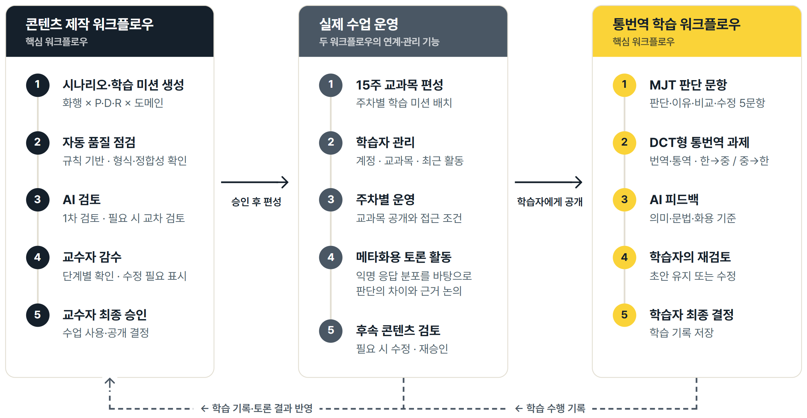
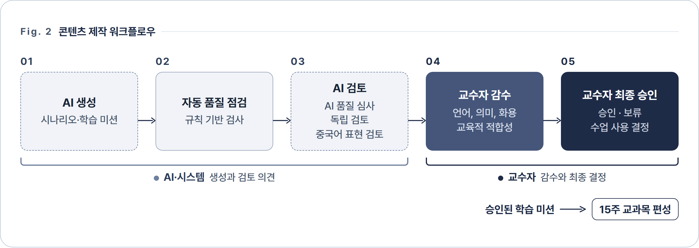
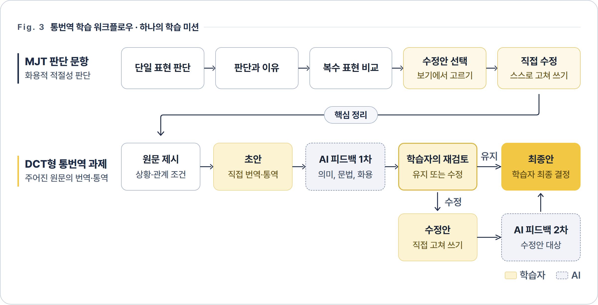
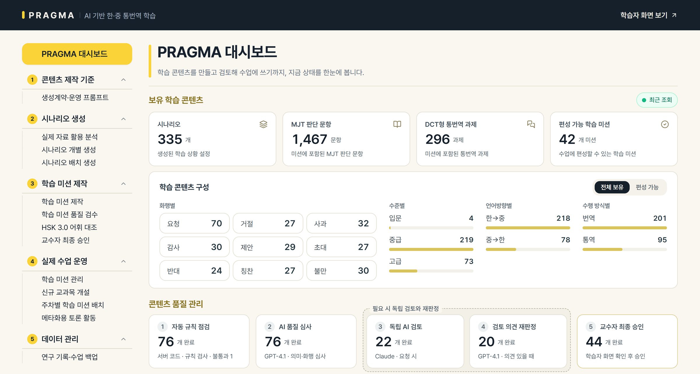
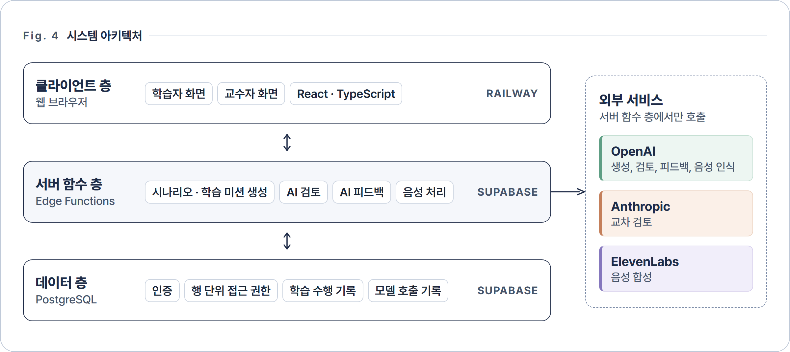

  

  
  

<h3 align="center">같은 뜻도, 상황과 관계에 따라 다르게 표현합니다.</h3>

PRAGMA는 한·중 통번역에서 원문의 의미와 화행 목적을 유지하면서, 
상황과 관계에 알맞은 표현을 탐구하는 통번역 학습 시스템입니다.

 

### 0. 바로 가기

<table>
  <thead><tr><th width="251" align="left">화면</th><th width="350" align="left">링크</th></tr></thead>
  <tbody>
    <tr><td>&nbsp;&nbsp;<b>웹앱</b></td><td><a href="https://pragma.up.railway.app">pragma.up.railway.app</a></td></tr>
    <tr><td>&nbsp;&nbsp;<b>학습 미션 체험</b></td><td><a href="https://pragma.up.railway.app/demo/mission">pragma.up.railway.app/demo/mission</a></td></tr>
    <tr><td>&nbsp;&nbsp;<b>PRAGMA 시스템 구조</b></td><td><a href="https://pragma.up.railway.app/architecture">pragma.up.railway.app/architecture</a></td></tr>
  </tbody>
</table>

> <small>PRAGMA의 핵심 화면 세 곳으로 바로 이동할 수 있습니다.</small>

 

### 1. PRAGMA 시스템 구조

> <small>콘텐츠 제작과 통번역 학습은 실제 수업 운영으로 이어지고, 학습 기록과 토론 결과는 다시 콘텐츠 검토에 쓰입니다.</small>

 

### 2. 학습 미션의 화용론적 설계

<table>
  <thead><tr><th width="172" align="left">조건</th><th width="507" align="left">구성</th></tr></thead>
  <tbody>
    <tr><td>목표화행</td><td>요청&ensp;|&ensp;거절&ensp;|&ensp;사과&ensp;|&ensp;감사&ensp;|&ensp;불만&ensp;|&ensp;칭찬&ensp;|&ensp;초대&ensp;|&ensp;제안&ensp;|&ensp;반대</td></tr>
    <tr><td>상황·관계 조건</td><td>상대적 권력(P)&ensp;|&ensp;사회적 거리(D)&ensp;|&ensp;행위 부담도(R)</td></tr>
    <tr><td>언어방향</td><td>한→중 · 중→한</td></tr>
    <tr><td>수행 방식</td><td>번역 · 통역</td></tr>
    <tr><td>학습자 수준</td><td>입문&ensp;|&ensp;중급&ensp;|&ensp;고급&ensp;(HSK 4·5·6급 누적 어휘 상한)</td></tr>
  </tbody>
</table>

> <small>9개 목표화행과 P·D·R 상황·관계 조건을 조합해 학습 미션을 구성합니다.</small>

 

### 3. 콘텐츠 제작 워크플로우

> <small>AI 생성 콘텐츠는 자동 점검과 AI 검토를 거쳐 교수자가 감수·최종 승인합니다.</small>

 

### 4. 통번역 학습 워크플로우

- **학습 미션**은 다섯 개의 MJT 판단 문항과 하나의 DCT형 통번역 과제로 구성됩니다.
- **MJT 판단 문항**에서는 제시된 표현의 화용적 적절성을 판단하고 선택하거나 수정합니다.
- **DCT형 통번역 과제**에서는 초안과 수정안에 각각 AI 피드백을 받은 뒤, 학습자가 최종안을 결정합니다.
- **AI 피드백**은 의미적 충실성·문법적 정확성·화용적 적절성의 세 기준으로 통번역을 검토합니다.
- **번역과 통역** 미션은 같은 구성을 따르며, 통역 미션에서는 속도와 휴지를 조정한 합성 음성을 듣고 통역합니다.

 

### 5. 수업 연계와 운영

<table>
  <thead><tr><th width="168" align="left">기능</th><th width="598" align="left">내용</th></tr></thead>
  <tbody>
    <tr><td>교과목 편성</td><td>번역·통역·통번역 교과목의 15주 계획에 승인된 학습 미션을 주차별로 배치</td></tr>
    <tr><td>학습자 관리</td><td>프로필 작성과 교수자의 가입 승인을 마친 학습자가 교과목에 참여</td></tr>
    <tr><td>메타화용 토론</td><td>학습자 응답 분포와 선택 이유를 바탕으로 판단의 차이와 근거를 수업에서 논의</td></tr>
    <tr><td>수행 현황</td><td>학습자별 미션 수행 상태와 기록을 확인</td></tr>
  </tbody>
</table>

> <small>교수자는 승인한 미션을 교과목에 편성하고, 학습자의 응답을 다시 수업으로 연결합니다.</small>

 

> <small>PRAGMA 대시보드</small>

 

### 6. 시스템 아키텍처

2026년 10월 기준

- **학습 미션 생성**은 GPT-5.5가 기본이며, 필요시 상위 모델인 GPT-6 Astra를 선택할 수 있습니다.
- **시나리오 생성**에는 GPT-4.1 mini를 사용합니다.
- **AI 검토**에는 GPT-4.1, 필요시 **독립 AI 검토**에는 Claude Opus 5를 사용합니다.
- **AI 피드백**에는 GPT-4.1 mini를 사용합니다.
- **통역**의 <b>음성 인식(STT)</b>은 GPT-4o Transcribe, <b>음성 합성(TTS)</b>은 ElevenLabs로 처리합니다.
- **구현**은 React·TypeScript와 Supabase Edge Functions·PostgreSQL로 구성됩니다.
- **코드 관리와 배포**는 PR과 main 갱신마다 자료형 검사·테스트·빌드를 자동 실행한 뒤 Railway로 배포합니다.

 

### 7. 콘텐츠·학습 기록의 추적

<table>
  <thead><tr><th width="343" align="left">콘텐츠 이력</th><th width="228" align="left">학습 수행 기록</th></tr></thead>
  <tbody>
    <tr><td>생성 조건 · AI 모델</td><td>MJT 응답과 선택 이유</td></tr>
    <tr><td>운영 프롬프트 SHA-256 지문</td><td>초안 · 수정안</td></tr>
    <tr><td>자동 규칙 점검 결과 · AI 검토 의견</td><td>제공된 AI 피드백</td></tr>
    <tr><td>교수자 최종 승인 이력 · 모델 호출 기록</td><td>최종안 · 학습자 의견</td></tr>
  </tbody>
</table>

> <small>생성·검토·승인 이력과 학습 기록을 콘텐츠 버전에 연결해 추적합니다.</small>

 

### 8. 학위논문과 구현의 대응

<table>
  <thead><tr><th width="88" align="left">논문</th><th width="314" align="left">내용</th><th width="414" align="left">구현 위치</th></tr></thead>
  <tbody>
    <tr><td nowrap>3.3</td><td nowrap>목표화행과 적절성 판단 기준</td><td nowrap><a href="src/lib/pragma/enums.ts"><code>enums.ts</code></a></td></tr>
    <tr><td nowrap>3.4</td><td nowrap>통번역 학습 워크플로우 설계</td><td nowrap><a href="src/lib/mission/canonicalMissionRuntime.ts"><code>canonicalMissionRuntime.ts</code></a></td></tr>
    <tr><td nowrap>3.5</td><td nowrap>콘텐츠 제작 워크플로우 설계</td><td nowrap><a href="supabase/functions/generate-scenario/"><code>generate-scenario/</code></a></td></tr>
    <tr><td nowrap>3.6</td><td nowrap>수업 운영 설계</td><td nowrap><a href="src/lib/curriculum/template.ts"><code>template.ts</code></a></td></tr>
    <tr><td nowrap>4.1</td><td nowrap>개발 환경과 시스템 아키텍처</td><td nowrap><a href=".github/workflows/ci.yml"><code>ci.yml</code></a> · <a href="supabase/migrations/"><code>migrations/</code></a></td></tr>
    <tr><td nowrap>4.2</td><td nowrap>통번역 학습 워크플로우 구현</td><td nowrap><a href="src/pages/learner/CanonicalMissionRun.tsx"><code>CanonicalMissionRun.tsx</code></a> · <a href="src/lib/mission/missionFeedback.ts"><code>missionFeedback.ts</code></a></td></tr>
    <tr><td nowrap>4.3</td><td nowrap>콘텐츠 제작 워크플로우 구현</td><td nowrap><a href="src/pages/admin/AdminGenerator.tsx"><code>AdminGenerator.tsx</code></a> · <a href="src/components/admin/ContentReviewPanel.tsx"><code>ContentReviewPanel.tsx</code></a></td></tr>
    <tr><td nowrap>4.4</td><td nowrap>수업 운영 기능</td><td nowrap><a href="src/pages/admin/AdminComposer.tsx"><code>AdminComposer.tsx</code></a> · <a href="src/components/admin/ClassResponsePanel.tsx"><code>ClassResponsePanel.tsx</code></a></td></tr>
    <tr><td nowrap>4.5</td><td nowrap>개발 과정의 문제 발견과 설계 개선</td><td nowrap><a href="https://github.com/sylim-research/PRAGMA/pulls?q=is%3Apr+is%3Amerged"><code>merged PRs</code></a></td></tr>
    <tr><td nowrap>부록&nbsp;A</td><td nowrap>한→중 번역 미션 사례</td><td nowrap><a href="src/lib/demo/representativeMissionSnapshot.ts"><code>representativeMissionSnapshot.ts</code></a></td></tr>
    <tr><td nowrap>부록&nbsp;B</td><td nowrap>콘텐츠 제작·검토 기준</td><td nowrap><a href="supabase/functions/content-review/"><code>content-review/</code></a></td></tr>
    <tr><td nowrap>부록&nbsp;C</td><td nowrap>주요 설계 판단과 개선</td><td nowrap><a href="https://github.com/sylim-research/PRAGMA/pulls?q=is%3Apr+is%3Amerged"><code>merged PRs</code></a></td></tr>
    <tr><td nowrap>부록&nbsp;D</td><td nowrap>수업 편성 예시</td><td nowrap><a href="src/components/admin/CurriculumSyllabus.tsx"><code>CurriculumSyllabus.tsx</code></a></td></tr>
  </tbody>
</table>

> <small>학위논문 제3·4장과 부록을 절 단위로 실제 코드에 대응시켰습니다.</small>

 

### 9. 주요 연구·개발 단계

<table>
  <thead><tr><th width="300" align="left">단계</th><th width="395" align="left">핵심 설계·개선</th><th width="110" align="left">근거</th></tr></thead>
  <tbody>
    <tr><td>통번역 학습 워크플로우</td><td>학습 미션 수행 흐름과 중→한 번역·통역 구현</td><td><a href="https://github.com/sylim-research/PRAGMA/pull/4">#4</a> · <a href="https://github.com/sylim-research/PRAGMA/pull/62">#62</a></td></tr>
    <tr><td>콘텐츠 품질 관리·최종 승인</td><td>자동 규칙 점검·AI 검토 뒤 교수자 최종 승인</td><td><a href="https://github.com/sylim-research/PRAGMA/pull/27">#27</a> · <a href="https://github.com/sylim-research/PRAGMA/pull/122">#122</a></td></tr>
    <tr><td>교과목·주차 편성</td><td>3개 교과목의 15주 계획과 주차 미션 연결</td><td><a href="https://github.com/sylim-research/PRAGMA/pull/25">#25</a> · <a href="https://github.com/sylim-research/PRAGMA/pull/87">#87</a></td></tr>
    <tr><td>MJT 판단 문항 → DCT형 통번역 과제</td><td>MJT와 통번역 과제를 한 학습 미션으로 승인·저장</td><td><a href="https://github.com/sylim-research/PRAGMA/pull/155">#155</a></td></tr>
    <tr><td>9개 목표화행 확장</td><td>요청 전용 미션 형식을 화행별 판단 기준으로 일반화</td><td><a href="https://github.com/sylim-research/PRAGMA/pull/184">#184</a></td></tr>
    <tr><td>의미적 충실성 우선 피드백</td><td>의미가 왜곡되면 문법·화용보다 의미를 먼저 안내</td><td><a href="https://github.com/sylim-research/PRAGMA/pull/196">#196</a></td></tr>
    <tr><td>수정안의 2차 AI 피드백</td><td>초안에만 주던 AI 피드백을 수정안에도 1회 추가</td><td><a href="https://github.com/sylim-research/PRAGMA/pull/248">#248</a></td></tr>
  </tbody>
</table>

> <small>개발 과정의 핵심 설계와 개선을 보여 주는 주요 변경 내역입니다.</small>

 

### 10. 주요 용어

<table>
  <thead><tr><th width="180" align="left">용어</th><th width="620" align="left">본 연구에서의 뜻</th></tr></thead>
  <tbody>
    <tr><td nowrap>워크플로우</td><td nowrap>주체별 활동의 순서와 수정·결정 조건을 명시한 절차</td></tr>
    <tr><td nowrap>시나리오</td><td nowrap>상황·관계와 원문을 하나로 묶은 콘텐츠 단위</td></tr>
    <tr><td nowrap>학습 미션</td><td nowrap>MJT 5문항과 DCT형 통번역 과제 1문항의 학습 단위</td></tr>
    <tr><td nowrap>MJT 판단 문항</td><td nowrap>제시된 표현의 적절성을 판단·선택·수정하는 문항</td></tr>
    <tr><td nowrap>DCT형 통번역 과제</td><td nowrap>DCT의 상황 제시 방식을 응용한 통번역 과제</td></tr>
    <tr><td nowrap>의미적 충실성</td><td nowrap>원문의 내용·화행목적·의도된 태도의 유지를 보는 기준</td></tr>
    <tr><td nowrap>문법적 정확성</td><td nowrap>목표어의 어순·형태·통사 규칙 부합을 보는 기준</td></tr>
    <tr><td nowrap>화용적 적절성</td><td nowrap>상황·관계에 비추어 표현 선택의 적절성을 보는 기준</td></tr>
    <tr><td nowrap>적절성 판단 범주</td><td nowrap>표현을 과소·적정·과잉으로 나누는 교육적 분류</td></tr>
  </tbody>
</table>

> <small>MJT: Metapragmatic Judgment Task · DCT: Discourse Completion Task</small>

 
 

<b>박사학위논문 「AI 기반 한·중 통번역 학습 워크플로우 개발 연구」의 설계·개발 결과물입니다.</b>  © 2026 Soyoung Lim · 한국외국어대학교

